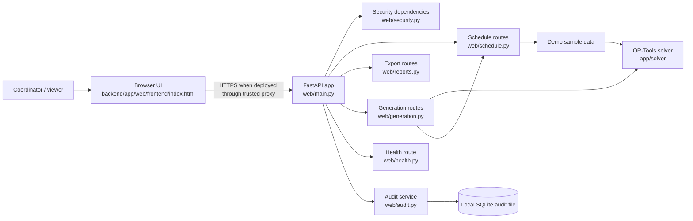
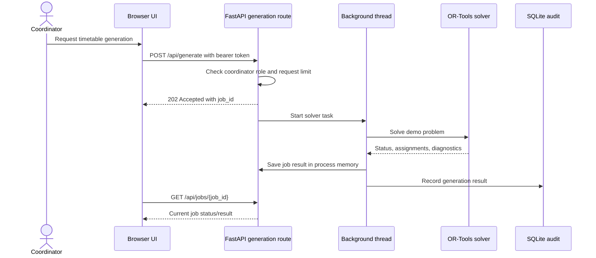
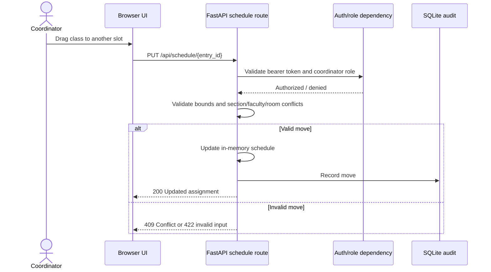

# Web Architecture Supplement for the SAD

This supplement describes the merged demo web layer. It is intended to accompany the approved SAD and can be incorporated into its architecture diagrams if the course requires a single revised PDF.

## Component view

## Async generation sequence

## Schedule move sequence

## Deployment and persistence limits

The demo schedule and async job map are process-local. Audit events use a local SQLite file. HTTPS is enforced only when configured behind a trusted TLS proxy. These diagrams describe the current code; they do not claim durable jobs, multi-instance coordination, deployed uptime, or production security certification.
